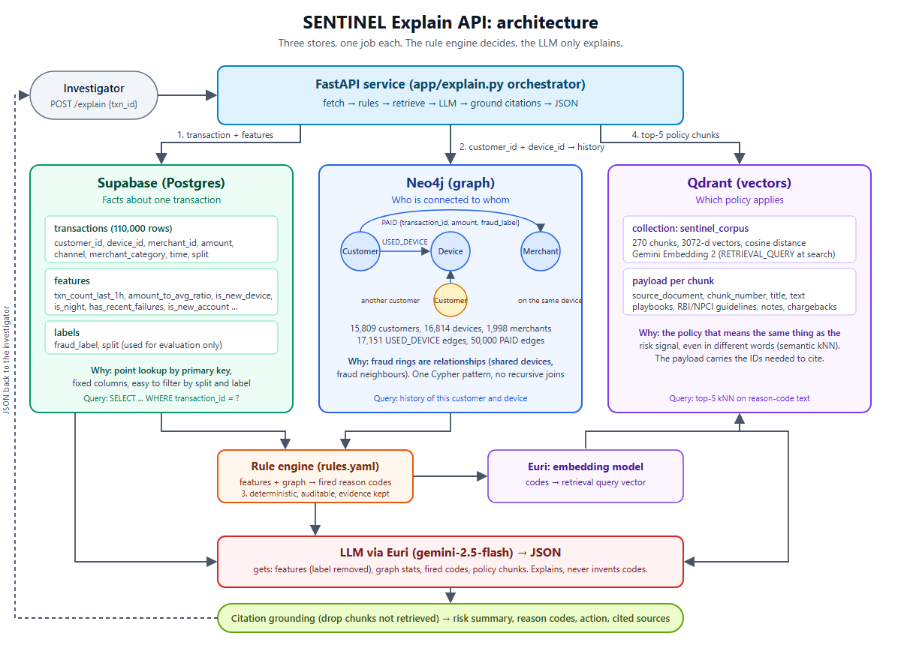
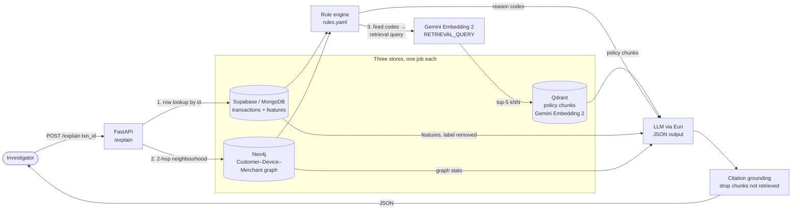

# SENTINEL Explain API

A small FastAPI service for fraud investigators. Send it a transaction ID and it returns a plain-English risk summary, the reason codes that fired, a recommended action, and the policy document + chunk that back up that action.

```
POST /explain  {"transaction_id": "T000123"}
```

```json
{
  "transaction_id": "T000123",
  "risk_level": "HIGH",
  "risk_summary": "…",
  "reason_codes": [{"code": "VELOCITY_1H", "description": "…", "evidence": "txn_count_1h=7.0 gte 5", "source": "features"}],
  "recommended_action": "HOLD_FOR_REVIEW",
  "action_rationale": "…",
  "cited_sources": [{"document": "velocity_rules_policy", "chunk_id": "c3", "quote": "…"}],
  "context_gaps": [],
  "debug": {"retrieval_query": "…", "retrieved": [...], "dropped_ungrounded_citations": [], "latency_ms": 2140}
}
```

---

## Architecture



Diagram files: [`docs/architecture.png`](docs/architecture.png) (image shown above) and [`docs/architecture.svg`](docs/architecture.svg) (editable vector source).

The same flow as a Mermaid diagram (renders on GitHub):



### Which database stores what, and why

| Store | What it holds | Why this store | Query in this service |
|---|---|---|---|
| **Supabase (Postgres)** or **MongoDB** | One row per transaction: raw fields plus the engineered features from task 1 (amount z-score, 1h velocity, device age, balance drain ratio…), the fraud label and the train/val/test split | Point lookup by primary key is the main access pattern. Features are fixed columns, and SQL makes it easy to filter by split and label for evaluation | `SELECT * WHERE transaction_id = ?` (plus a join to the features table) |
| **Neo4j** | Customers, devices and merchants as nodes, with `USED_DEVICE` and `PAID` edges (each `PAID` edge is one transaction carrying its fraud label) (task 2) | Fraud rings show up as *relationships*: one device shared by four customers, or a customer two hops from a confirmed fraudster. In SQL that takes recursive self-joins; in Cypher it is a single pattern match | A 2-hop neighbourhood query that returns device sharing, the device's fraud history and fraudulent neighbours |
| **Qdrant** | Fraud-policy documents split into chunks, each with a 3072-d Gemini Embedding 2 vector and a `{source_document, chunk_number, title, text}` payload (task 4) | Investigators need the policy that *means the same thing* as the risk signal, even when it uses different words. That calls for semantic kNN, not keyword search. The payload carries the IDs needed to cite | kNN search with an embedding of the fired reason-code descriptions |

### Design decisions

- **The rule engine fires the reason codes; the LLM only explains them.** Codes are computed from `rules.yaml` before the LLM is called, so they are reproducible and auditable, and the model can't make one up. Every code shows the exact value that tripped it in `evidence`.
- **Retrieval is driven by the reason codes.** The search query is built from the descriptions of the codes that fired (for example "Burst of transactions in the last hour"). That is the wording the policy documents use, so it retrieves better than embedding raw JSON.
- **Citations are grounded.** Any citation whose `(document, chunk_id)` pair was not in the retrieved top-5 is removed and logged in `debug.dropped_ungrounded_citations`.
- **The label is never sent to the LLM.** `is_fraud` and `split` are stripped from the context, so the explanation can't simply read off the answer (this is covered by a unit test).
- **The service degrades instead of failing.** If Neo4j or Qdrant is down, the response still comes back, and `context_gaps` says what was missing.
- **The query embedding must match the index.** It uses `task_type=RETRIEVAL_QUERY` and the same `EMBED_DIM` as task 4. A mismatched dimension makes the scores meaningless.

---

## Setup

```bash
python -m venv .venv && source .venv/bin/activate   # Windows: .venv\Scripts\activate
pip install -r requirements.txt
cp .env.example .env        # fill in Supabase/Mongo, Neo4j, Qdrant and Euri keys
```

**Map to your schemas.** All table, collection and payload field names are environment variables (see `.env.example`). Rename the `field:` entries in `app/rules.yaml` to match your task-1 feature columns; rules whose field is missing are skipped. If your graph uses different labels or relationship types, edit `NEIGHBOURHOOD_CYPHER` in `app/stores/graph.py`.

```bash
uvicorn app.main:app --reload        # docs at http://localhost:8000/docs
pytest -q                            # offline tests with fake stores (no keys needed)
```

## Evaluation

### 1. Ten test transactions (5 fraud + 5 genuine, validation split)

```bash
python -m scripts.run_test_transactions                  # picks from rows where split = 'val'
# or: python -m scripts.run_test_transactions --ids-csv eval/val_ids.csv   (columns: transaction_id,is_fraud)
```

The script calls the running API and saves each response to `results/explain/<id>.json`, with a summary in `results/test_run_summary.md`.

| transaction_id | label | risk | action | reason codes | cites | correct |
|---|---|---|---|---|---|---|
| TX_0000082299 | fraud | HIGH | HOLD_FOR_REVIEW | AMT_HIGH, AMT_ABS_HIGH, VELOCITY_1H, NIGHT_TXN, RECENT_FAILURES | 1 | yes |
| TX_0000082609 | fraud | MEDIUM | HOLD_FOR_REVIEW | NIGHT_TXN, RECENT_FAILURES | 2 | yes |
| TX_0000083035 | fraud | HIGH | HOLD_FOR_REVIEW | AMT_HIGH, VELOCITY_1H, NIGHT_TXN, RECENT_FAILURES, MCC_HIGH_RISK | 1 | yes |
| TX_0000083044 | fraud | HIGH | HOLD_FOR_REVIEW | AMT_ABS_HIGH, NIGHT_TXN, RECENT_FAILURES | 0 | yes |
| TX_0000083048 | fraud | HIGH | HOLD_FOR_REVIEW | AMT_HIGH, NIGHT_TXN, RECENT_FAILURES | 0 | yes |
| TX_0000082051 | genuine | LOW | APPROVE | NIGHT_TXN | 1 | yes |
| TX_0000082052 | genuine | MEDIUM | STEP_UP_AUTH | NEW_DEVICE, NIGHT_TXN | 1 | no |
| TX_0000082053 | genuine | LOW | APPROVE | NIGHT_TXN | 1 | yes |
| TX_0000082054 | genuine | LOW | STEP_UP_AUTH | NIGHT_TXN | 1 | no |
| TX_0000082055 | genuine | MEDIUM | STEP_UP_AUTH | NIGHT_TXN, RECENT_FAILURES | 2 | no |

Flag-vs-label agreement: **70%** (anything other than APPROVE counts as flagged)

Note: Neo4j was connected for this run (no `context_gaps`). The graph holds only the first 50,000 transactions (historical data), so the validation transactions are not in it. The service looks up each transaction's customer and device and queries their prior history instead. Most validation customers have little history there, so the graph rules (DEVICE_SHARED, DEVICE_FRAUD_HISTORY, RING_NEIGHBOUR) rarely fire. The remaining false flags come from NIGHT_TXN, NEW_DEVICE and RECENT_FAILURES, which also occur in genuine traffic.

### 2. Retrieval hit@5

`eval/retrieval_questions.json` holds 10 questions, each labelled with the document that contains the answer. To check the labels against your real document IDs:

```bash
python -m scripts.list_policy_docs     # shows every doc_id in the collection
python -m scripts.eval_retrieval       # writes results/retrieval_eval.md
```

A question counts as a hit if any of its top-5 chunks comes from the expected document (exact match or substring match). The script also reports MRR, which shows how high the correct document ranks.

**hit@5 = 10/10 = 100%**  |  MRR = 1.000

| id | question | expected doc | hit | rank | top-1 doc |
|---|---|---|---|---|---|
| Q01 | What should an analyst do when a customer is tricked by a caller into sharing an OTP? | playbook/pb-otp-vishing.txt | yes | 1 | playbook/pb-otp-vishing.txt |
| Q02 | How should an account takeover from a newly registered device be handled? | playbook/pb-ato-new-device.txt | yes | 1 | playbook/pb-ato-new-device.txt |
| Q03 | What are the containment steps for a remote access app scam where the victim installed screen sharing software? | playbook/pb-remote-access.txt | yes | 1 | playbook/pb-remote-access.txt |
| Q04 | How do I detect and respond to card testing with many small payments at one merchant? | playbook/pb-card-testing.txt | yes | 1 | playbook/pb-card-testing.txt |
| Q05 | What is the procedure when a mule account is receiving fraud proceeds? | playbook/pb-mule-account.txt | yes | 1 | playbook/pb-mule-account.txt |
| Q06 | How is a fraudulent UPI collect request approved by the victim handled? | playbook/pb-collect-request.txt | yes | 1 | playbook/pb-collect-request.txt |
| Q07 | What are the signs of SIM swap fraud and what should the bank do? | playbook/pb-sim-swap.txt | yes | 1 | playbook/pb-sim-swap.txt |
| Q08 | What are the RBI rules on cooling period for newly added beneficiaries? | guideline/rbi-beneficiary-cooling.txt | yes | 1 | guideline/rbi-beneficiary-cooling.txt |
| Q09 | What are the NPCI limits for UPI transactions? | guideline/npci-upi-limits.txt | yes | 1 | guideline/npci-upi-limits.txt |
| Q10 | How should digital arrest impersonation scams by fake police callers be handled? | playbook/pb-digital-arrest-copy.txt | yes | 1 | playbook/pb-digital-arrest-copy.txt |

## Repo layout

```
app/
  main.py            FastAPI app, POST /explain, GET /health
  explain.py         orchestrator: fetch → rules → retrieve → LLM → ground
  rules.yaml         reason-code rules (edit field names to match your features)
  reason_codes.py    rule engine
  llm.py             prompt, Euri LLM call, JSON parsing, citation grounding
  schemas.py         request / response models
  config.py          settings from .env
  stores/
    transactions.py  Supabase + MongoDB backends
    graph.py         Neo4j neighbourhood Cypher
    policy.py        Qdrant + Gemini Embedding 2 (via Euri) retrieval
docs/                architecture.png / architecture.svg diagram, screenshots/
scripts/             run_test_transactions, eval_retrieval, list_policy_docs
eval/                retrieval_questions.json
results/             saved /explain responses and eval reports
tests/               offline pipeline tests
```
